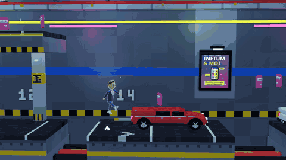
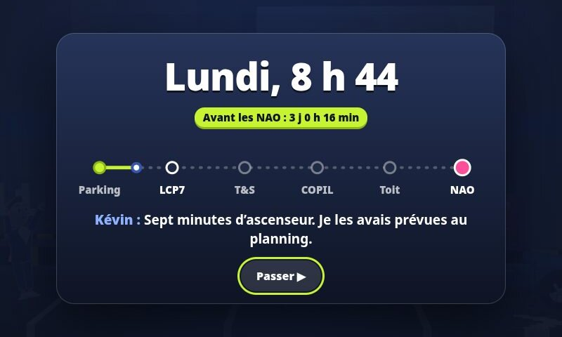
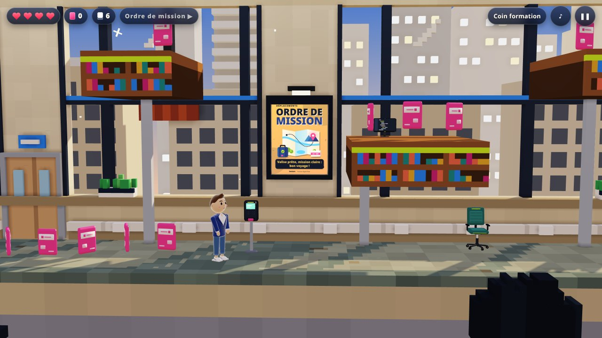
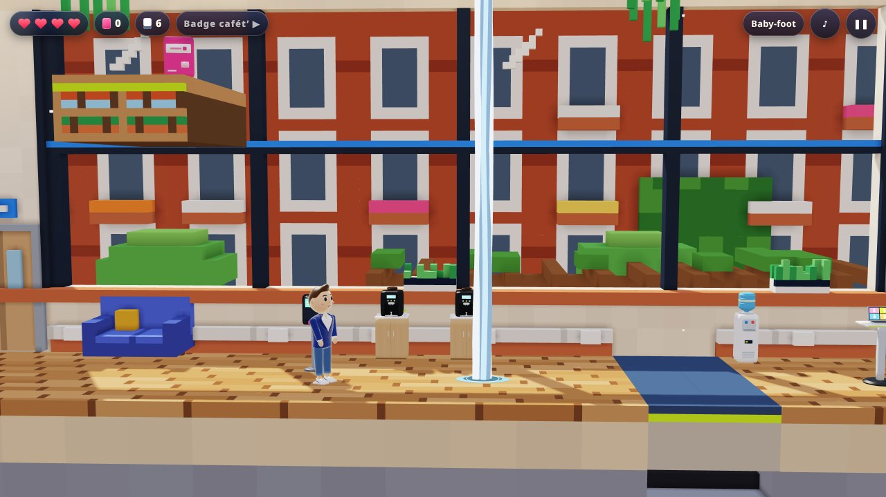
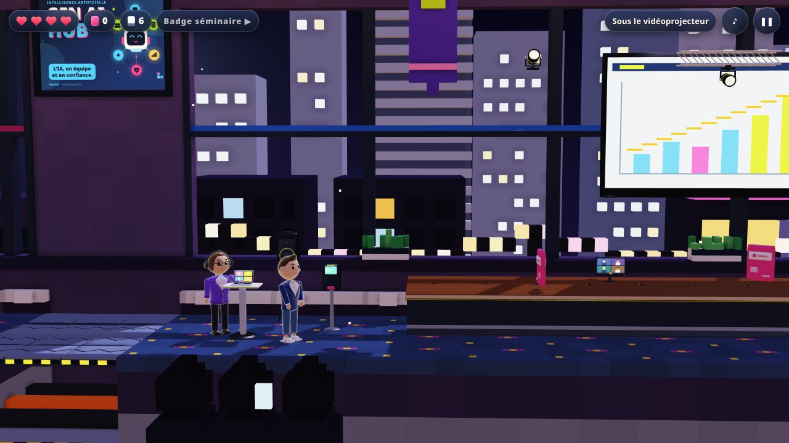

# NAO Rush

**Un jeu de plateforme dans les bureaux d’Inetum, façon Rick Dangerous et Prince of Persia.**

Les NAO commencent jeudi et l’enveloppe des augmentations s’est perdue en circuit de validation. Avec Kévin ou Charline, traverse le parking, l’open space de LCP7, la salle serveurs de Technologies & Services, le comité de pilotage et le toit du Power UP Tour pour la faire signer à temps.

Un clin d’œil affectueux à la vie en ESN : ici, personne n’est ridiculisé. Les directeurs sont des boss imposants et charismatiques qu’on convainc à coups de comptes rendus, et chaque combat se termine par une signature commune.

▶ **[Jouer dans le navigateur](https://c0sm0cats.github.io/naorush/)** : PC, tablette et mobile, sans installation. Il faut un navigateur récent compatible WebGL2 (Chrome, Edge, Firefox, Safari 15 ou plus).




L’écran d’accueil vit à l’heure réelle : lumière du matin, du jour, du soir ou de la nuit, une phrase pour chaque jour de la semaine et « Jour des NAO ! » le jeudi. Kévin et Charline y discutent en attendant que tu choisisses.

## Les cinq étapes

Chaque étape compte de 10 à 12 salles, avec ses bornes Chronotime, ses secrets et son objet à rapporter.

|                                               |                                                                                                                                                                                                                                                                                              |
| --------------------------------------------- | -------------------------------------------------------------------------------------------------------------------------------------------------------------------------------------------------------------------------------------------------------------------------------------------- |
|          | **1. Parking B2.** Le tutoriel, lundi à 8 h 40 : toits des voitures, monte-charges, passerelle, bornes de recharge et la rampe d’accès. Le premier sol mouillé (panneau jaune) et les robots aspirateurs, qui font d’excellents tremplins. Objectif : le badge visiteur près des ascenseurs. |
|        | **2. Open space LCP7.** Fauteuils qui roulent tout seuls, tiroirs qui claquent, dalles piégées, stagiaires pressés, feu croisé d’imprimantes, cabines téléphoniques et archives. Objectif : le bon de commande signé, et en chemin deux places pour le concert de Céline Dion.               |
|  | **3. Technologies & Services.** La salle serveurs : fosse à câbles en nacelle, allée froide sur le toit des baies, faux plancher, onduleurs et sprinklers de la salle de refroidissement. Au bout, dans son bureau : Julien.                                                                 |
|    | **4. Comité de pilotage.** Salle de crise, grande table du COPIL, amphi des KPI et ses vidéoprojecteurs, régie (sa vanne coupe les sprinklers), ascenseur de direction. Il faut faire valider le compte rendu.                                                                               |
|       | **5. Power UP Tour.** Le toit au coucher du soleil : une descente de quinze mètres depuis la cage d’escalier, puis le château d’eau, l’antenne relais, les panneaux solaires, l’héliport et cinq nacelles au-dessus du vide. Rodolphe attend à l’Espace VIP.                                 |

Entre deux étapes de l’histoire, un court interlude (passable) montre le trajet de la semaine, l’horloge qui avance jusqu’à l’étape suivante, le compte à rebours avant les NAO de jeudi et une réplique du héros.

<p align="center"></p>

## Les boss

|                                     |                                                                                                                                                                                                                                                                                                                                                                                                                                                           |
| ----------------------------------- | --------------------------------------------------------------------------------------------------------------------------------------------------------------------------------------------------------------------------------------------------------------------------------------------------------------------------------------------------------------------------------------------------------------------------------------------------------- |
|      | **Julien, Directeur Technologies & Services Pays de la Loire.** Calme, précis, redoutable. Son écran de supervision s’allume à son entrée. Salves de slides KPI, baies serveurs qui descendent sur ton ombre (la supervision en enchaîne trois), câbles sous tension et fenêtre de maintenance où tout le sol s’allume sauf une zone. En deuxième phase, il bascule sur son site de secours : téléportation, répartition de charge et bascule de circuit. |
|  | **Rodolphe, Directeur Région Ouest.** Le grand show du Power UP Tour, son nom en lettres lumineuses : slides en éventail (et un rappel qui tombe dans les trous du premier), sauts qui font trembler la scène, projecteurs qui frappent au sol. En deuxième phase, la tournée régionale à toute allure, aller et retour. Puis le grand final : le projecteur te suit, les slides pleuvent, la scène tremble deux fois.                                    |

Un duel dure un peu plus d’une minute. Chaque attaque est annoncée au sol au moins 0,6 s avant de toucher, et l’arène change avec le combat : en deuxième phase, deux marches apparaissent (des baies qui montent du faux plancher chez Julien, des structures qui descendent des cintres chez Rodolphe) pour prendre de la hauteur au-dessus des attaques au sol. Quand un directeur consulte PRIMO, sa garde tombe (un compte à rebours s’affiche) : c’est le moment de lui envoyer un compte rendu. Une fois convaincu, il signe l’enveloppe : tout le monde gagne.

## Les étapes bonus

Débloquées une fois l’enveloppe signée.

|                                               |                                                                                                                                                                                                        |
| --------------------------------------------- | ------------------------------------------------------------------------------------------------------------------------------------------------------------------------------------------------------ |
|   | **Intercontrat.** Un jeudi matin calme sur le plateau : la fosse, l’escalier des étagères, le mur des CV, la salle du courrier, sept nacelles et l’ascenseur panoramique. Un ordre de mission au bout. |
|        | **Salle de pause.** Coin café, file du micro-ondes, baby-foot, distributeurs et coin sieste, puis une course-poursuite avec les bonbonnes d’eau pour ramener le badge cafét’.                          |
|  | **Séminaire annuel.** Gradins de la plénière, passerelle lumière, coulisses et loges, cocktail, buffet et la photo de groupe, sous le feu des vidéoprojecteurs, en soirée.                             |

## Deux héros, deux façons de jouer

|                          | Kévin, Directeur de Projets                 | Charline, Business Manager     |
| ------------------------ | ------------------------------------------- | ------------------------------ |
| Cœurs                    | 4                                           | 3                              |
| Comptes rendus au départ | 6                                           | 5                              |
| Saut                     | Simple, mais il s’accroche plus haut        | Double saut                    |
| Course                   | Posée                                       | Plus rapide                    |
| Comptes rendus           | Lourds : ils cassent les cartons d’archives | Plus rapides                   |
| Secrets                  | Derrière les cartons d’archives             | Sur les rebords les plus hauts |

Chacun a ses propres répliques, dans les dialogues comme dans les interludes.

## Commandes

| Action                          | Clavier                    | Manette      | Mobile |
| ------------------------------- | -------------------------- | ------------ | ------ |
| Courir                          | ← →                        | Stick, croix | ◀ ▶    |
| Sauter, s’accrocher à un rebord | Espace                     | A            | SAUT   |
| Grimper, lire un tableau blanc  | ↑                          | Haut         | ▲      |
| Lâcher le rebord                | ↓                          | Bas          | ▼      |
| Regarder autour                 | ↑ ou ↓ maintenu, à l’arrêt | Haut ou bas  | ▲ ou ▼ |
| Lancer un compte rendu          | X                          | X ou Y       | CR     |
| Pause                           | Échap                      | Start        | ❚❚     |
| Retour dans les menus           | Échap                      | B            | Fermer |

Badge aux bornes Chronotime : en cas de pépin, tu repars de là. Les ramettes de papier rechargent les comptes rendus, les cafés rendent un cœur. Chaque piège prévient (une secousse, un voyant, une goutte) et se répète à l’identique au deuxième essai. Gare aux flaques signalées par un panneau jaune et au sol sous les sprinklers : ça glisse, il faut freiner plus tôt. La progression est sauvegardée à chaque étape, et en pause la musique passe en attente téléphonique.

## Pour rejouer

- **Défi du jour** : la même étape, le même héros et la même contrainte pour tout le monde, étapes bonus comprises. Sept contraintes : contre la montre, un seul cœur, sans CR au départ, sans badge Chronotime, mode Sans filet, un secret à dénicher, ou sous le chrono d’argent. Étapes et contraintes sont distribuées comme des cartes : toutes reviennent à chaque cycle, jamais deux jours de suite. De quoi comparer ses temps entre collègues.
- **Chapitres** : rejoue n’importe quelle étape déjà terminée, avec ton record, tes secrets par héros et ta médaille.
- **Médailles** : par étape et par héros, l’or sous 1,6 fois le temps de la route la plus rapide, l’argent sous 2,5 fois, le bronze sinon, et une étoile sans retour au badge. En mode détente ou en vitesse réduite, la médaille reste au bronze et le jeu dit pourquoi. L’écran de résultats donne l’écart avec la médaille suivante et un indice pour un secret manqué.
- **Mode Sans filet**, débloqué après le générique : un seul cœur, pas de café, des pièges plus vifs et des directeurs plus pressés. Records à part.
- **Secrets** : deux par étape, un pour chaque héros.
- **Trophées** : vingt-deux objectifs (étapes sans faute, boss convaincus sans être touché, tous les secrets de chaque héros, l’or partout, les places pour Céline…).
- **Records** : meilleur temps par étape et par héros.
- **Distribution** : tous les personnages en 3D, avec leur portrait en quelques mots. Et la galerie des 32 affiches Inetum du jeu, en plein écran.
- **Partager mon score** : partage natif sur mobile, texte prêt à coller dans Teams sur PC.

## Accessibilité et confort

- **Mode détente** : aucun cœur perdu, jamais de fin de partie ; une chute ramène simplement au dernier badge.
- **Vitesse du jeu** : normale, réduite (80 %) ou très réduite (65 %), hors défi du jour.
- **Options** : volumes, secousses de l’écran, flashs, contraste élevé, vibrations, taille des boutons tactiles, touches personnalisables. Les réglages « réduire les animations » et « contraste élevé » du système sont repris par défaut.
- **Repères renforcés** : contours hachurés sur tout ce qui blesse, et des avertissements qui se lisent à la forme, pas seulement à la couleur.
- **Sous-titres des sons** : chaque bruit d’alerte s’écrit entre crochets, du côté d’où il vient (« [Imprimante qui chauffe →] »).
- **Astuces à tes touches** : les conseils nomment les touches que tu as choisies, les boutons de ta manette ou ceux de l’écran tactile.
- **Lecteurs d’écran** : dialogues, interludes et cœurs annoncés (« 3 cœurs sur 4 »), menus étiquetés ; Tab reste dans la fenêtre ouverte.
- **Mobile** : en portrait, une caméra plus serrée, un héros plus grand et une vue qui anticipe les chutes ; en paysage, les messages tiennent sur une ligne.
- **Menus** : utilisables entièrement au clavier, à la manette ou au doigt. Sur mobile, on peut glisser d’un bouton à l’autre sans lever le doigt.
- **Installation** : le jeu s’installe comme une application (PWA). Tout est mis en cache dès l’installation : il reste jouable hors ligne, et une mise à jour remplace la version entière d’un coup.

## Sous le capot

- **Rendu** : moteur WebGL2 écrit pour le jeu (ombres du soleil, lumières ponctuelles, occlusion ambiante, tonemapping ACES).
- **Géométrie** : décors en voxels (maillage glouton), personnages et accessoires en géométrie lisse procédurale.
- **Images** : les affiches, les tableaux blancs des boss et les plaques sont dessinés en code (Canvas 2D).
- **Son** : musique (un thème principal qui revient dans chaque étape et chaque boss, avec des couches qui montent pendant l’action, et sa version en attente téléphonique), ambiances de fond (serveurs, vent, parking…) et bruitages, tout synthétisé en direct avec WebAudio. Aucun fichier son.
- **Simulation** : déterministe à 60 Hz. Dans les tests, un solveur finit chaque étape avec les deux héros et convainc chaque directeur sans prendre un coup, et un test de non-blocage vérifie qu’aucun héros ne peut rester coincé dans le décor.

### Prérequis

Node.js 22.12 ou plus récent, et npm.

```sh
npm install
npm run dev          # http://localhost:5173
npm run check        # lint, types, tests (dont le solveur), build
npm run smoke        # test de bout en bout (Playwright, PC et mobile)
npm run screenshots  # captures et GIF du README (avec npm run dev lancé, et ffmpeg)
npm run sweep        # parcourt toutes les étapes et signale les erreurs (avec npm run dev lancé)
```

Pages de vérification en développement : `?sounds` pour écouter chaque musique et chaque bruitage, `?gallery` pour voir tous les personnages de près.

| Dossier          | Contenu                                                                                                         |
| ---------------- | --------------------------------------------------------------------------------------------------------------- |
| `src/game/`      | Simulation : `world.js` (types, collisions), `sim.js` (héros), `traps.js`, `enemies.js`, `boss.js`, `solver.js` |
| `src/gfx/`       | Rendu WebGL2, voxels, personnages, accessoires, affiches, tableaux                                              |
| `src/app/`       | Scène, caméra, entrées, interface, interlude, médailles, défi du jour, trophées, effets, audio                  |
| `src/data/`      | Étapes (`levels/`), distribution, répliques, contenus Inetum                                                    |
| `tests/`, `e2e/` | Tests unitaires et de bout en bout                                                                              |
| `docs/`          | Captures et [guide pour créer une étape](docs/CREER-UNE-ETAPE.md)                                               |

Le déploiement sur GitHub Pages est automatique à chaque push sur `main`.

## Crédits

Toutes les situations du jeu sont imaginaires : c’est un clin d’œil affectueux aux temps forts de la vie chez Inetum (badgeage Chronotime, tickets Swile, NAO, comités de pilotage, Power UP Tour…). Inetum est une marque de son propriétaire. Ce projet personnel n’est ni affilié à Inetum ni approuvé par elle.

Code sous licence [MIT](LICENSE).
