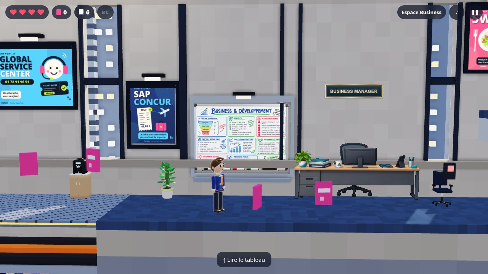
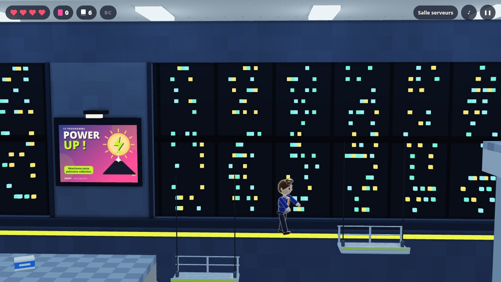
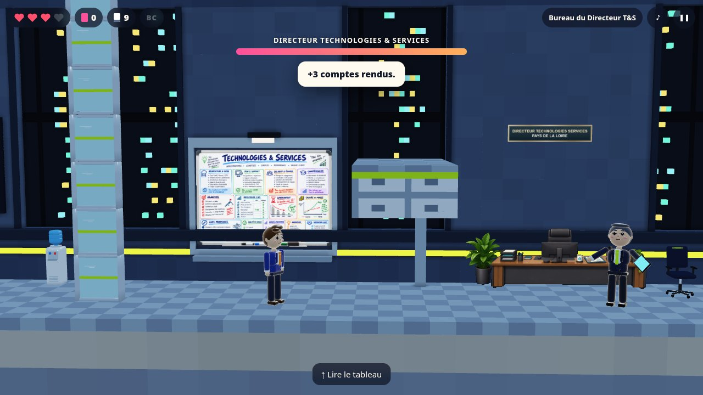
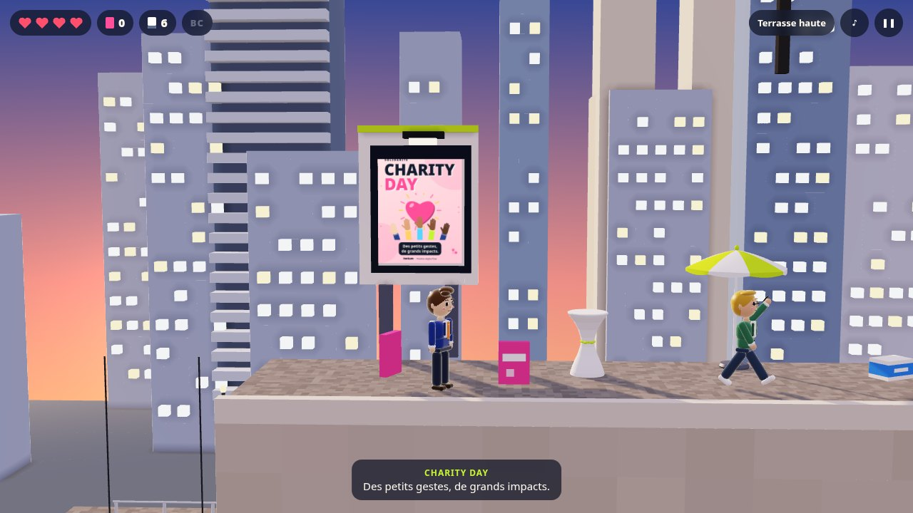

# NAO Rush

**Un jeu de plateforme dans les bureaux d’Inetum, façon Rick Dangerous et Prince of Persia.**

Les NAO commencent jeudi et l’enveloppe des augmentations a disparu. Avec Kévin ou Charline, traverse l’open space de LCP7, la salle serveurs de Technologies & Services et le rooftop du Power UP Tour pour la faire signer à temps.

▶ **[Jouer dans le navigateur](https://c0sm0cats.github.io/naorush/)** : PC, tablette et mobile, sans installation.


## Les trois étapes

|                                     |                                                                                                                                                                                                   |
| ----------------------------------- | ------------------------------------------------------------------------------------------------------------------------------------------------------------------------------------------------- |
|  | **1. Open space LCP7.** Dalles qui s’effondrent, câbles à nu, bonbonne d’eau en roue libre et un collègue en call qui bloque le couloir. Trouve le bon de commande signé.                         |
|   | **2. Technologies & Services.** Nacelles au-dessus d’une fosse à câbles, baies serveurs à escalader, passerelle fragile. Au bout : Julien, Directeur Technologies & Services Pays de la Loire.    |
|               | **Les boss.** Ils lancent des slides KPI. Quand ils consultent PRIMO, leur garde tombe : c’est le moment de leur envoyer un compte rendu.                                                         |
|          | **3. Power UP Tour.** Le toit au coucher du soleil, des trous dans la toiture et la nacelle du laveur de vitres. Rodolphe, Directeur Région Ouest, attend à l’Espace VIP… avec des ondes de choc. |


## Deux héros, deux façons de jouer

- **Kévin, Directeur de Projets** : 4 cœurs, 6 comptes rendus, s’accroche plus haut.
- **Charline, Business Manager** : plus rapide, double saut, des CR qui volent plus loin.

## Commandes

| Action                          | Clavier | Mobile |
| ------------------------------- | ------- | ------ |
| Courir                          | ← →     | ◀ ▶    |
| Sauter, s’accrocher à un rebord | Espace  | SAUT   |
| Grimper, lire un tableau blanc  | ↑       | ▲      |
| Lâcher le rebord                | ↓       | ▼      |
| Lancer un compte rendu          | X       | CR     |
| Pause                           | Échap   | ❚❚     |

Badge aux bornes Chronotime : en cas de pépin, tu repars de là. Les ramettes de papier rechargent tes comptes rendus. La progression est sauvegardée à chaque étape.

## Sous le capot

- Moteur **WebGL2** écrit pour le jeu : ombres du soleil, lumières ponctuelles, occlusion ambiante, tonemapping ACES.
- Décors en **voxels** (maillage glouton), personnages et accessoires en **géométrie lisse** procédurale.
- Toutes les **affiches** Inetum sont dessinées en code (Canvas 2D), en haute résolution.
- **Musique et bruitages** synthétisés en direct avec WebAudio, sans aucun fichier son.
- **Simulation déterministe** à 60 Hz. Un solveur rejoue chaque étape avec les deux héros dans les tests : chaque niveau est prouvé finissable.

```sh
npm install
npm run dev          # http://localhost:5173
npm run check        # lint, types, tests, build
npm run smoke        # test de bout en bout (Playwright)
```

| Dossier          | Contenu                                                  |
| ---------------- | -------------------------------------------------------- |
| `src/game/`      | Simulation (physique, pièges, boss) et solveur           |
| `src/gfx/`       | Rendu WebGL2, voxels, personnages, accessoires, affiches |
| `src/app/`       | Caméra, entrées, HUD, scène, effets, audio               |
| `src/data/`      | Étapes, distribution, contenus Inetum                    |
| `tests/`, `e2e/` | Tests unitaires et de bout en bout                       |

Le déploiement sur GitHub Pages est automatique à chaque push sur `main`.

## Crédits

Toutes les situations du jeu sont imaginaires : c’est un clin d’œil affectueux aux temps forts de la vie chez Inetum (badgeage Chronotime, tickets Swile, NAO, Power UP Tour…). Inetum est une marque de son propriétaire. Ce projet personnel n’est ni affilié à Inetum ni approuvé par elle.

Code sous licence [MIT](LICENSE).
