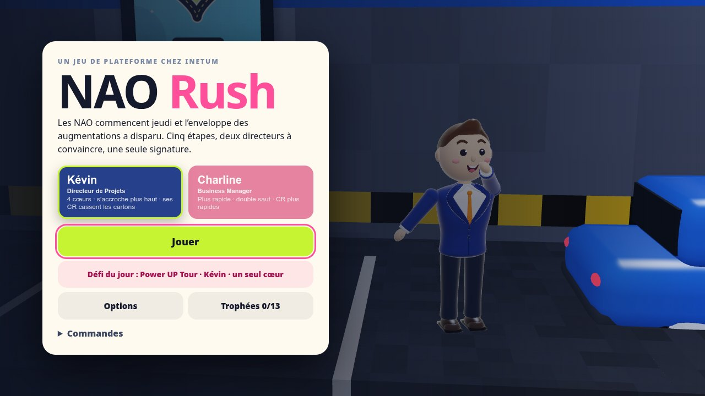
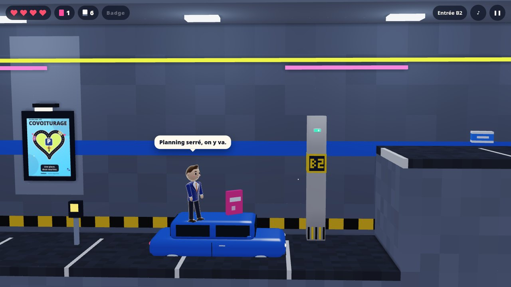
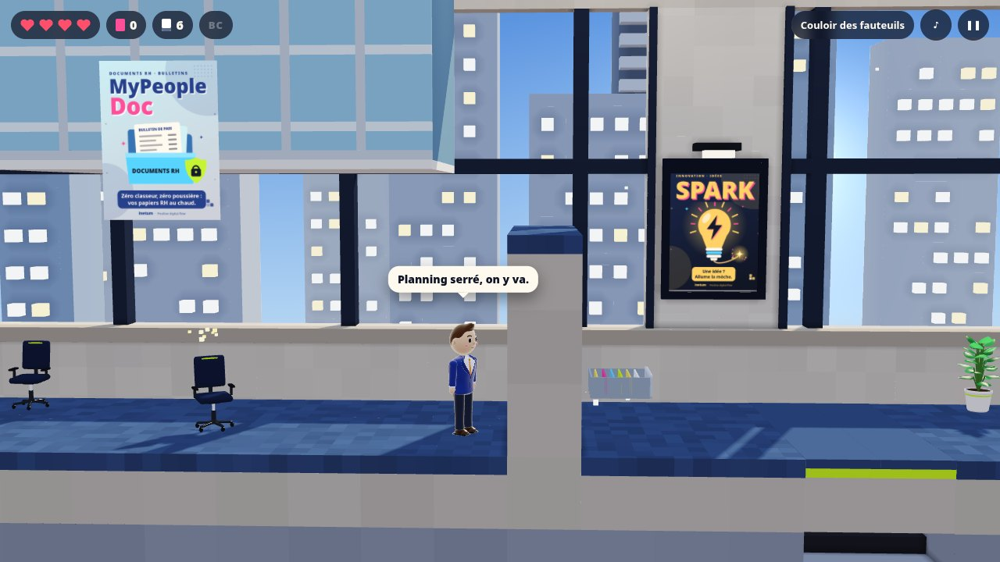
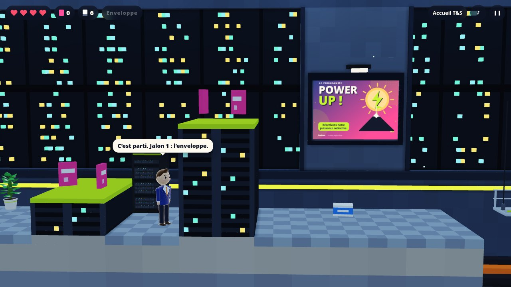
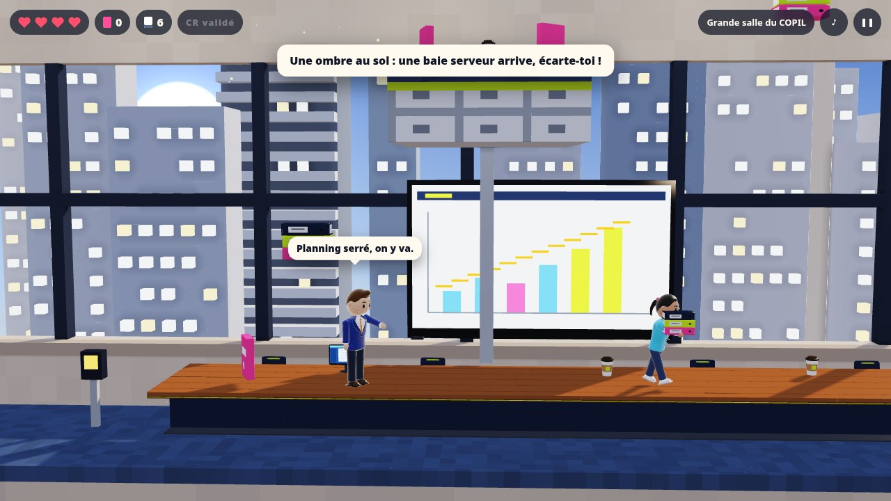
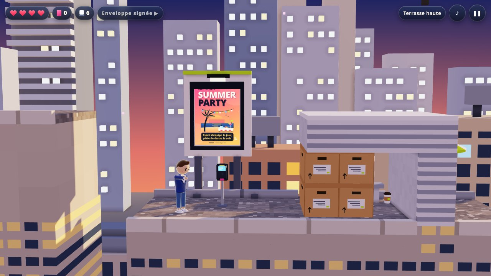
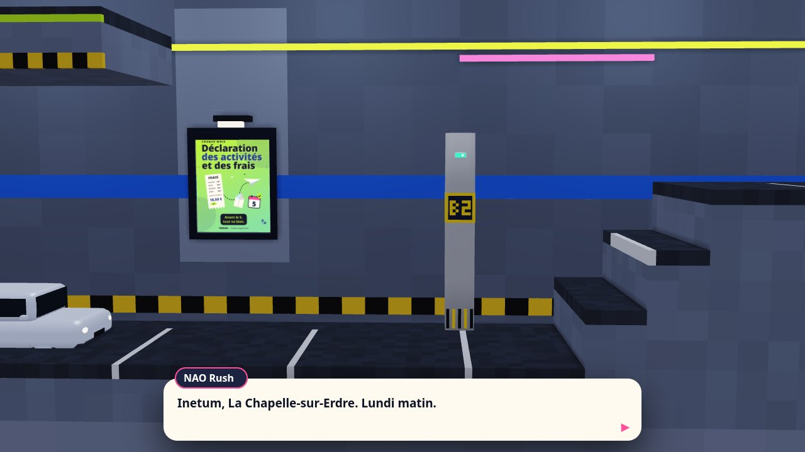
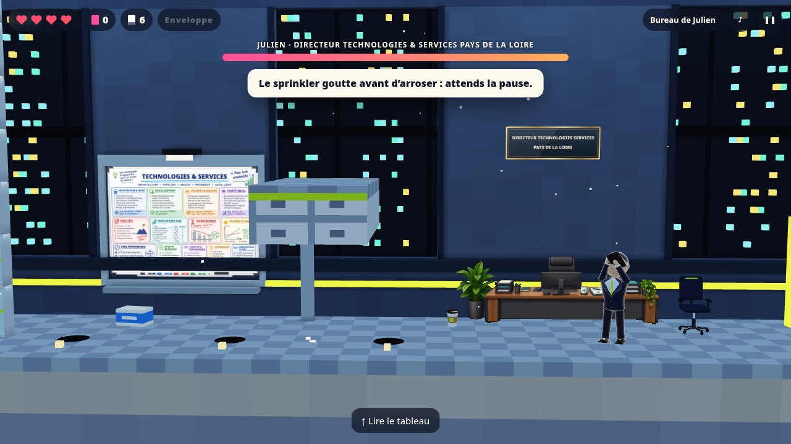
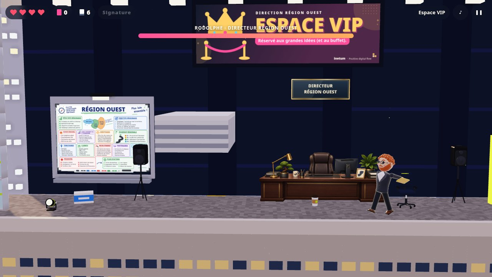

# NAO Rush

**Un jeu de plateforme dans les bureaux d’Inetum, façon Rick Dangerous et Prince of Persia.**

Les NAO commencent jeudi et l’enveloppe des augmentations a disparu. Avec Kévin ou Charline, traverse le parking, l’open space de LCP7, la salle serveurs de Technologies & Services, le comité de pilotage et le rooftop du Power UP Tour pour la faire signer à temps.

▶ **[Jouer dans le navigateur](https://c0sm0cats.github.io/naorush/)** : PC, tablette et mobile, sans installation. Il faut un navigateur récent compatible WebGL2 (Chrome, Edge, Firefox, Safari 15 ou plus).



## Les cinq étapes

|                                               |                                                                                                                                                                                        |
| --------------------------------------------- | -------------------------------------------------------------------------------------------------------------------------------------------------------------------------------------- |
|          | **1. Parking B2.** Le tutoriel : toits des voitures, premier rebord, collègue en call et badge visiteur à retrouver.                                                                   |
|        | **2. Open space LCP7.** Fauteuils qui roulent tout seuls, tiroirs qui claquent, dalles piégées, stagiaire pressé et bonbonne d’eau en roue libre. Objectif : le bon de commande signé. |
|  | **3. Technologies & Services.** Nacelles au-dessus d’une fosse à câbles, baies serveurs, sprinklers, robot aspirateur et chef de projet en visio. Au bout : Julien.                    |
|    | **4. Comité de pilotage.** Tables de réunion à arpenter, invitations qui volent bas, imprimantes en rafale. Il faut faire valider le compte rendu.                                     |
|       | **5. Power UP Tour.** Le toit au coucher du soleil, des trous dans la toiture et la nacelle du laveur de vitres. Rodolphe attend à l’Espace VIP.                                       |



## Les boss

|                                     |                                                                                                                                                                                                                                                                                         |
| ----------------------------------- | --------------------------------------------------------------------------------------------------------------------------------------------------------------------------------------------------------------------------------------------------------------------------------------- |
|      | **Julien, Directeur Technologies & Services Pays de la Loire.** Calme, précis, redoutable. Il enchaîne des salves de slides KPI et fait descendre des baies serveurs (une ombre au sol prévient). En deuxième phase, il bascule sur son site de secours et met des câbles sous tension. |
|  | **Rodolphe, Directeur Région Ouest.** Le grand show du Power UP Tour : slides lancées en éventail, sauts qui font trembler la scène et ondes de choc. En deuxième phase, une tournée régionale à toute allure (suis les flèches au sol) et des projecteurs qui balaient la scène.       |

Quand un directeur consulte PRIMO, sa garde tombe : c’est le moment de lui envoyer un compte rendu. Une fois convaincu, il signe l’enveloppe : tout le monde gagne.

## Deux héros, deux façons de jouer

|                          | Kévin, Directeur de Projets                 | Charline, Business Manager     |
| ------------------------ | ------------------------------------------- | ------------------------------ |
| Cœurs                    | 4                                           | 3                              |
| Comptes rendus au départ | 6                                           | 5                              |
| Saut                     | Simple, mais il s’accroche plus haut        | Double saut                    |
| Course                   | Posée                                       | Plus rapide                    |
| Comptes rendus           | Lourds : ils cassent les cartons d’archives | Plus rapides                   |
| Secrets                  | Derrière les cartons d’archives             | Sur les rebords les plus hauts |

## Commandes

| Action                          | Clavier | Manette      | Mobile |
| ------------------------------- | ------- | ------------ | ------ |
| Courir                          | ← →     | Stick, croix | ◀ ▶    |
| Sauter, s’accrocher à un rebord | Espace  | A            | SAUT   |
| Grimper, lire un tableau blanc  | ↑       | Haut         | ▲      |
| Lâcher le rebord                | ↓       | Bas          | ▼      |
| Lancer un compte rendu          | X       | X ou B       | CR     |
| Pause                           | Échap   | Start        | ❚❚     |

Les touches se changent dans **Options**, avec aussi un **mode détente** (les obstacles ne coûtent pas de cœur), les volumes, les secousses, les flashs, le contraste élevé, les vibrations et la taille des boutons tactiles. Sur mobile, on peut glisser d’un bouton à l’autre sans lever le doigt.

Chaque jour, un **défi du jour** propose à tout le monde la même étape, le même héros et la même contrainte (un seul cœur, pas de CR au départ…) : de quoi comparer ses temps entre collègues, avec le bouton **Partager mon score**. Une fois l’enveloppe signée, une **étape bonus** se débloque : l’Intercontrat, un parcours d’escalade semé de tickets. Treize **trophées** attendent les joueurs les plus curieux (secrets, étapes sans faute, boss convaincus sans être touché…). Le jeu s’installe comme une application (PWA) et reste jouable hors ligne une fois chargé.

Badge aux bornes Chronotime : en cas de pépin, tu repars de là. Les ramettes de papier rechargent les comptes rendus, les cafés rendent un cœur. Chaque piège prévient (une secousse, un voyant, une goutte) et se répète à l’identique au deuxième essai. La progression est sauvegardée à chaque étape.

## Sous le capot

- **Rendu** : moteur WebGL2 écrit pour le jeu (ombres du soleil, lumières ponctuelles, occlusion ambiante, tonemapping ACES).
- **Géométrie** : décors en voxels (maillage glouton), personnages et accessoires en géométrie lisse procédurale.
- **Images** : les affiches, les tableaux blancs des boss et les plaques sont dessinés en code (Canvas 2D).
- **Son** : musique (un thème par étape et par boss, avec des couches qui montent pendant l’action) et bruitages synthétisés en direct avec WebAudio. Aucun fichier son.
- **Simulation** : déterministe à 60 Hz. Un solveur rejoue chaque étape avec les deux héros dans les tests, et chaque niveau est prouvé finissable.

### Prérequis

Node.js 22.12 ou plus récent, et npm.

```sh
npm install
npm run dev          # http://localhost:5173
npm run check        # lint, types, tests (dont le solveur), build
npm run smoke        # test de bout en bout (Playwright, PC et mobile)
npm run screenshots  # captures du README (avec npm run dev lancé)
```

Pages de vérification en développement : `?sounds` pour écouter chaque musique et chaque bruitage, `?gallery` pour voir tous les personnages de près.

| Dossier          | Contenu                                                                                                         |
| ---------------- | --------------------------------------------------------------------------------------------------------------- |
| `src/game/`      | Simulation : `world.js` (types, collisions), `sim.js` (héros), `traps.js`, `enemies.js`, `boss.js`, `solver.js` |
| `src/gfx/`       | Rendu WebGL2, voxels, personnages, accessoires, affiches, tableaux                                              |
| `src/app/`       | Scène, caméra, entrées, interface, effets, audio                                                                |
| `src/data/`      | Étapes (`levels/`), distribution, répliques, contenus Inetum                                                    |
| `tests/`, `e2e/` | Tests unitaires et de bout en bout                                                                              |
| `docs/`          | Captures et [guide pour créer une étape](docs/CREER-UNE-ETAPE.md)                                               |

Le déploiement sur GitHub Pages est automatique à chaque push sur `main`.

## Crédits

Toutes les situations du jeu sont imaginaires : c’est un clin d’œil affectueux aux temps forts de la vie chez Inetum (badgeage Chronotime, tickets Swile, NAO, comités de pilotage, Power UP Tour…). Inetum est une marque de son propriétaire. Ce projet personnel n’est ni affilié à Inetum ni approuvé par elle.

Code sous licence [MIT](LICENSE).
